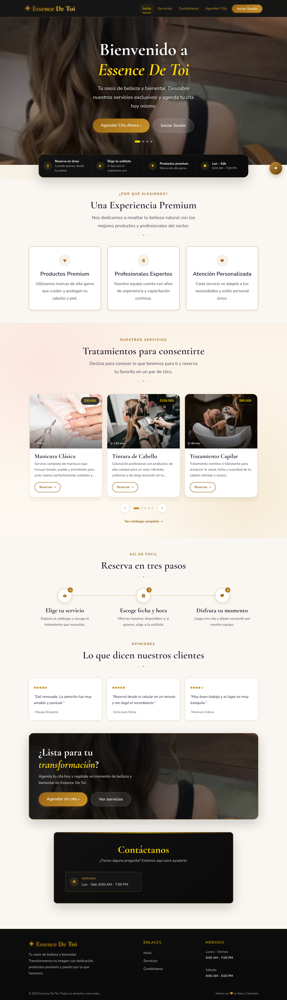
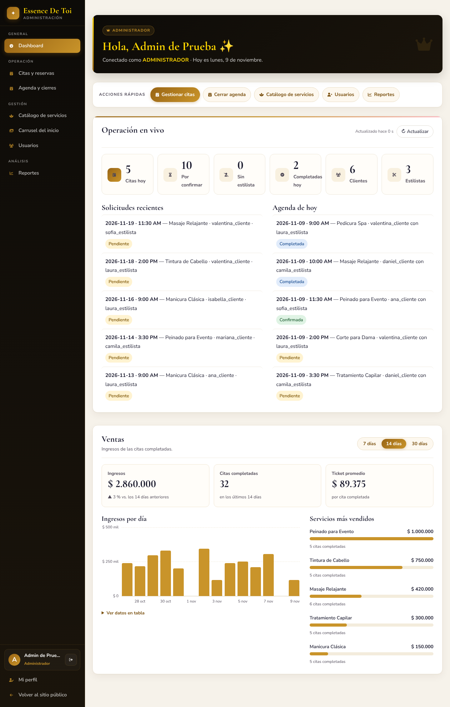
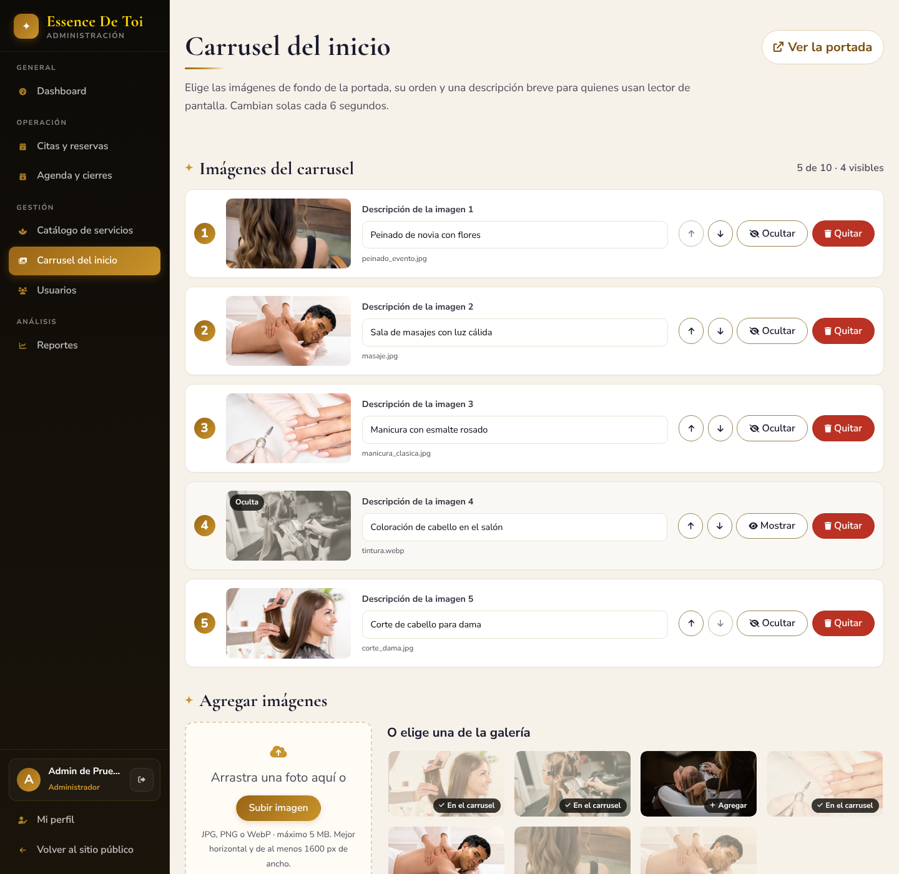
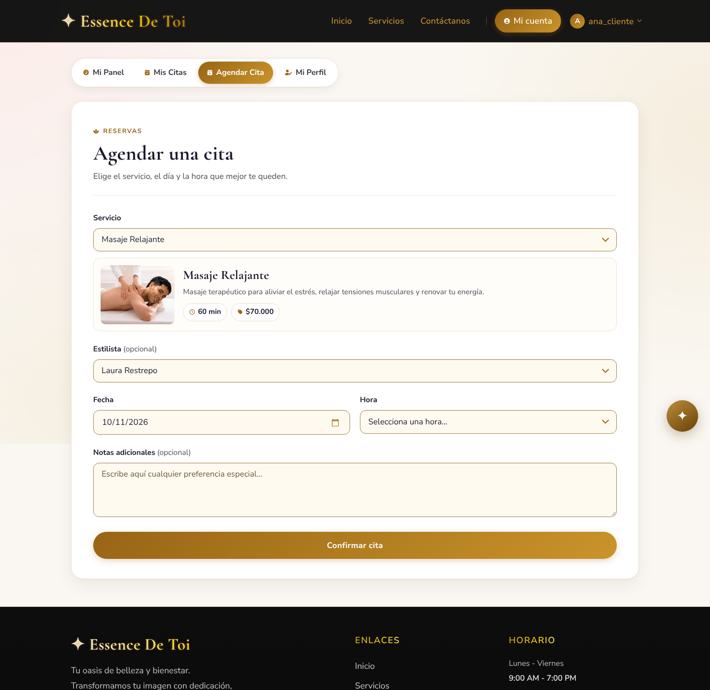
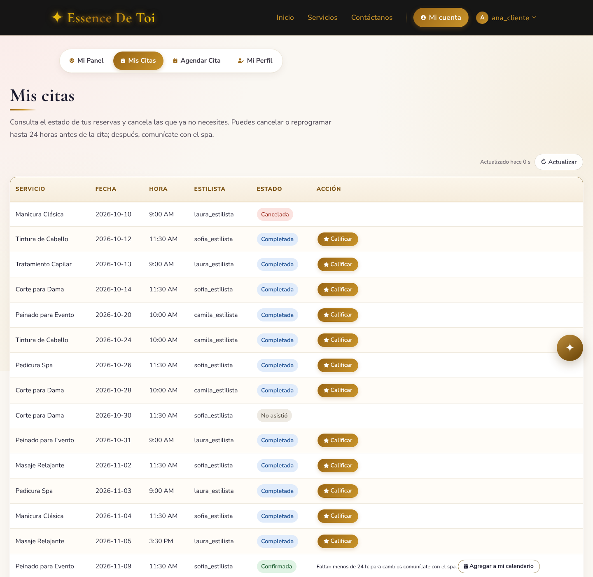
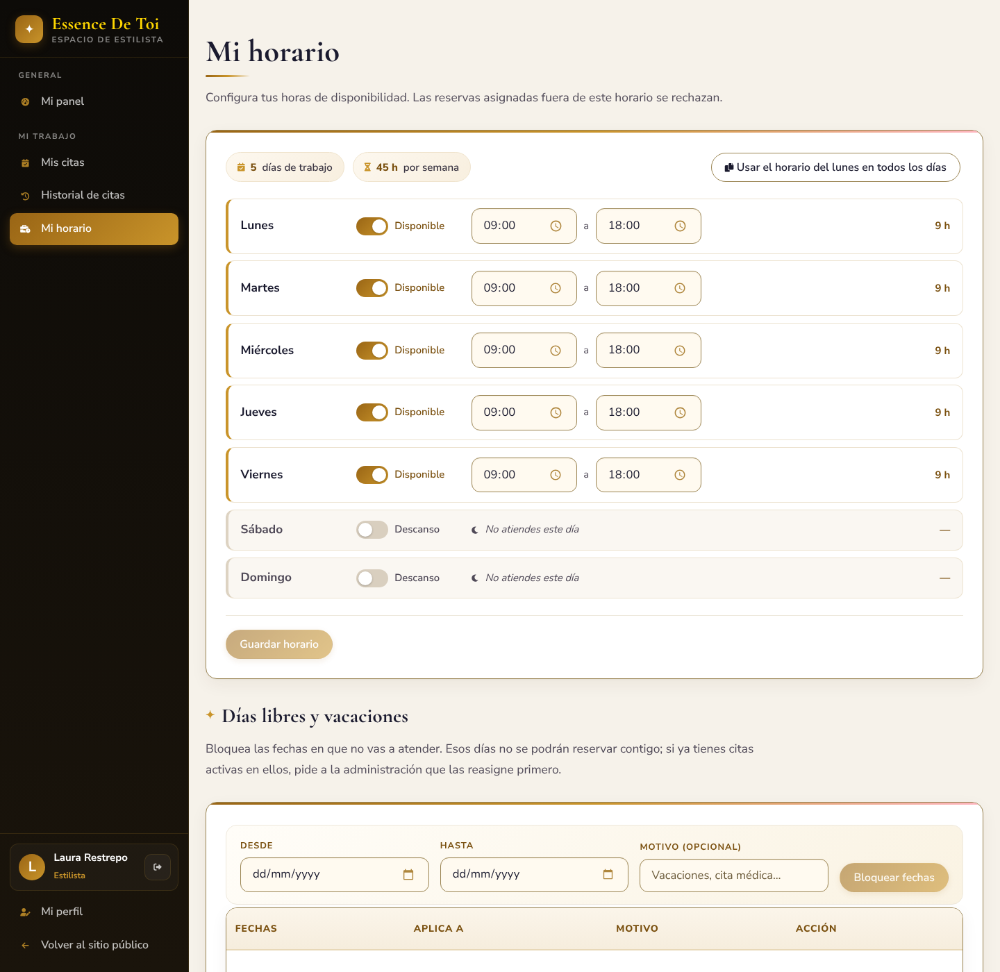
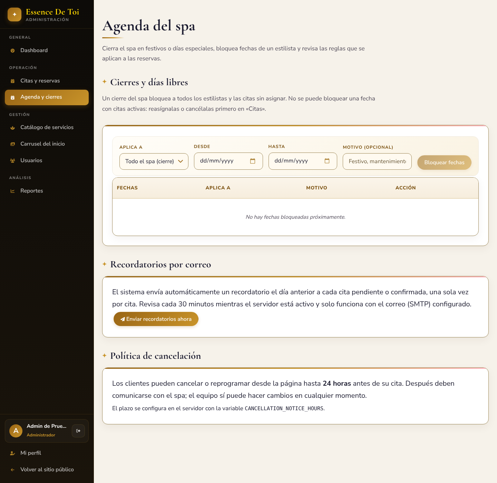

# Prototipo de la solución

Archivo de Figma: [Essence De Toi - Prototipo](https://www.figma.com/design/rX2rnjTX5xZH9lAjWEauvs).

Las pantallas de abajo son capturas del sitio funcionando (frontend real en React, escritorio 1440 px),
con datos de ejemplo. Están en la carpeta [`capturas/`](capturas/).

> Capturas tomadas el 08/11/2026 sobre la versión 1.3, con el frontend real y datos de ejemplo (la fecha del
> navegador se fijó en el lunes 9 de noviembre de 2026 para que hubiera citas del día). Las capturas 02, 05, 18,
> 22 y 23 vienen de la versión anterior y siguen vigentes porque esas pantallas no cambiaron.

## Sitio público

| Pantalla | Historia de usuario | Captura |
|---|---|---|
| Inicio con el carrusel de la portada que elige el administrador, carrusel de servicios y testimonios | Ver servicios destacados y opiniones | [01-inicio.png](capturas/01-inicio.png) |
| Catálogo de servicios con botón Reservar | Consultar el catálogo y reservar | [02-catalogo-servicios.png](capturas/02-catalogo-servicios.png) |
| Inicio de sesión con el botón Continuar con Google | Iniciar sesión (EDT-HU-002 y EDT-HU-032) | [03-inicio-sesion.png](capturas/03-inicio-sesion.png) |
| Registro con el botón de Google y el botón para mostrar la contraseña | Crear una cuenta (EDT-HU-001 y EDT-HU-033) | [04-registro.png](capturas/04-registro.png) |
| Recuperación de contraseña | Recuperar la contraseña | [05-recuperar-contrasena.png](capturas/05-recuperar-contrasena.png) |

## Cliente

| Pantalla | Captura |
|---|---|
| Mi cuenta: pestaña Mi Panel | [26-mi-cuenta-pestanas.png](capturas/26-mi-cuenta-pestanas.png) |
| Formulario de reserva con la vista previa del servicio elegido | [06-reserva.png](capturas/06-reserva.png) |
| Mis citas: reprogramar, cancelar, calificar y agregar al calendario | [07-mis-citas.png](capturas/07-mis-citas.png) |
| Mis citas: formulario para reprogramar | [07b-mis-citas-reprogramar.png](capturas/07b-mis-citas-reprogramar.png) |
| Mis citas: calificar una cita completada | [07c-mis-citas-calificar.png](capturas/07c-mis-citas-calificar.png) |
| Mi perfil | [17-mi-perfil.png](capturas/17-mi-perfil.png) |
| Asistente de chat abierto | [18-chat-asistente.png](capturas/18-chat-asistente.png) |

## Estilista

| Pantalla | Captura |
|---|---|
| Panel del estilista con menú lateral | [08-estilista-panel.png](capturas/08-estilista-panel.png) |
| Citas asignadas | [09-estilista-citas.png](capturas/09-estilista-citas.png) |
| Mi horario y días libres | [10-estilista-horario.png](capturas/10-estilista-horario.png) |
| Citas en vista de calendario (semana) | [20-estilista-calendario.png](capturas/20-estilista-calendario.png) |
| Notas internas sobre un cliente | [21-notas-cliente.png](capturas/21-notas-cliente.png) |

## Administrador

| Pantalla | Captura |
|---|---|
| Dashboard del administrador con menú lateral, indicadores y gráficas de ventas | [11-admin-panel.png](capturas/11-admin-panel.png) |
| Gráficas de ventas (7, 14 o 30 días) | [25-admin-graficas-ventas.png](capturas/25-admin-graficas-ventas.png) |
| Carrusel del inicio | [24-admin-carrusel-inicio.png](capturas/24-admin-carrusel-inicio.png) |
| Todas las citas con el botón Exportar a Excel | [12-admin-citas.png](capturas/12-admin-citas.png) |
| Citas en vista de calendario (por estilista) | [19-admin-calendario.png](capturas/19-admin-calendario.png) |
| Agenda: cierres, días libres, recordatorios y política de cancelación | [13-admin-agenda.png](capturas/13-admin-agenda.png) |
| Usuarios | [14-admin-usuarios.png](capturas/14-admin-usuarios.png) |
| Servicios | [15-admin-servicios.png](capturas/15-admin-servicios.png) |
| Reportes con el botón Exportar a Excel | [16-admin-reportes.png](capturas/16-admin-reportes.png) |
| Archivo Excel exportado desde Todas las citas (abierto en LibreOffice) | [27-excel-citas-exportado.png](capturas/27-excel-citas-exportado.png) |

## Correos que envía el sistema

Ejemplos con el texto real de las plantillas del backend, mostrados como se verían en la bandeja de entrada.

| Correo | Captura |
|---|---|
| Recordatorio de cita (día anterior) | [22-correo-recordatorio.png](capturas/22-correo-recordatorio.png) |
| Recuperación de contraseña | [23-correo-recuperar-contrasena.png](capturas/23-correo-recuperar-contrasena.png) |

## Vista previa

